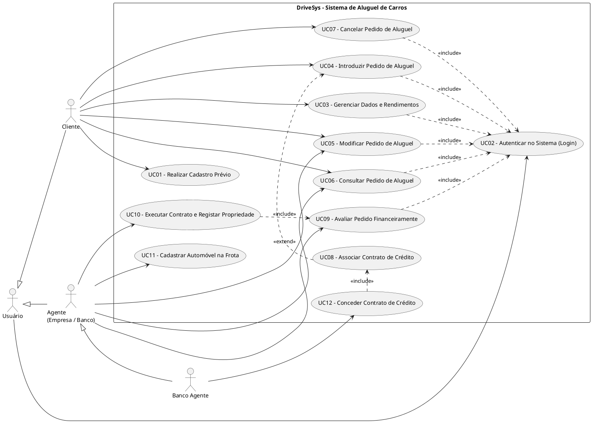
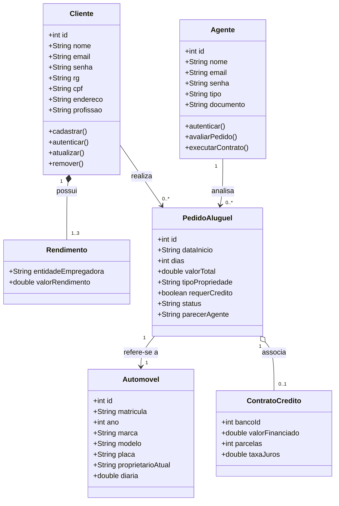
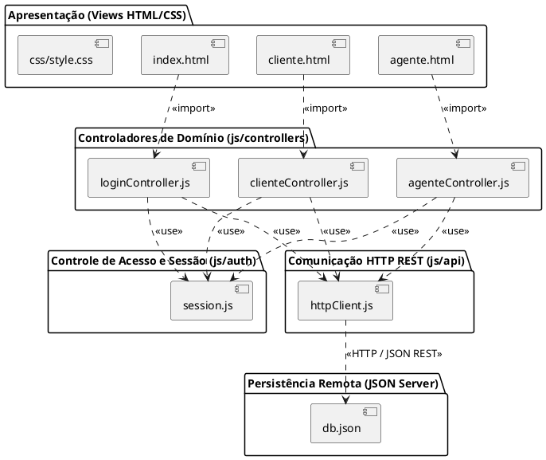
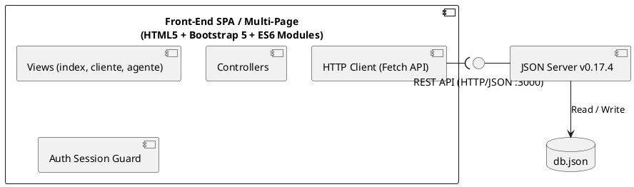

# Sistema de Aluguel de Carros (DriveSys)


> **Pontifícia Universidade Católica de Minas Gerais (PUC Minas)**  
> **Curso:** Ciências da Computação (2º Período - Manhã)  
> **Disciplina:** Desenvolvimento de Interfaces Web (DIW) — Laboratório 02  
> **Professor:** João Paulo Carneiro Aramuni  

---

## 📌 Descrição do Projeto

O **DriveSys** é um sistema web modular de apoio à gestão de aluguéis de automóveis que exige **cadastro prévio e autenticação por perfil** (`Cliente` ou `Agente`) antes de liberar o acesso às funcionalidades.

* **Clientes autenticados** podem introduzir, consultar, modificar e cancelar os seus próprios pedidos de aluguel, além de manter os seus dados cadastrais e até 3 entidades empregadoras/rendimentos.
* **Agentes autenticados (Empresas Locadoras e Bancos)** possuem portal exclusivo para avaliar financeiramente os pedidos com base nos rendimentos do cliente, emitir parecer positivo ou negativo, executar contratos aprovados (atualizando o registo de propriedade da viatura) e gerir a frota de automóveis.
* Toda a persistência de dados ocorre exclusivamente via API REST (`Fetch API` + `JSON Server` em `db.json`).

---

## 👥 Integrantes

* Felipe Henrique Moreira Jales

---

## 📝 Histórias de Usuário

| ID | Ator | História de Usuário | Critério de Aceitação |
| :--- | :--- | :--- | :--- |
| **HU01** | Visitante / Cliente | Como **Visitante**, quero realizar o meu cadastro prévio (com e-mail, senha, RG, CPF, endereço, profissão e até 3 rendimentos) e efetuar login no sistema. | O sistema deve validar e-mail único, limitar a 3 rendimentos, persistir no `db.json` via `Fetch API` e restringir o acesso por perfil. |
| **HU02** | Cliente | Como **Cliente autenticado**, quero introduzir, consultar, modificar e cancelar os meus pedidos de aluguel de automóveis pela Internet. | O pedido inicia com status *"Em Análise Financeira"* e só permite edição ou cancelamento pelo próprio contratante antes da execução. |
| **HU03** | Agente (Empresa/Banco) | Como **Agente autenticado**, quero analisar financeiramente os pedidos com base nos rendimentos do cliente e emitir parecer positivo ou negativo. | Apenas utilizadores com perfil `AGENTE` acessam o painel de avaliação e aprovação financeira. |
| **HU04** | Banco Agente | Como **Banco Agente**, quero associar um contrato de crédito ao pedido de aluguel quando solicitado pelo cliente. | O pedido deve registar o banco concessor, valor financiado, número de parcelas e taxa de juros. |
| **HU05** | Agente | Como **Agente**, ao executar um contrato aprovado, quero registar a propriedade do automóvel (`Cliente`, `Empresa` ou `Banco`). | A propriedade da viatura na frota deve ser atualizada no `db.json` conforme o tipo de contrato executado. |

---

## 📐 Modelagem do Sistema (UML)

> **Nota sobre a Notação UML:** Os diagramas abaixo seguem estritamente a especificação **UML 2.5**, gerados a partir de código **PlantUML**.

### 1. Diagrama de Casos de Uso (UML)


**Código-fonte PlantUML:**


---

### 2. Diagrama de Classes (UML)



---

### 3. Diagrama de Pacotes (UML — Organização Modular Real do Código)


**Código-fonte PlantUML:**


---

### 4. Diagrama de Componentes (UML)


**Código-fonte PlantUML:**


---

## 🔄 Evolução e Revisão dos Modelos ao Longo do Projeto

1. **Autenticação e Controle de Acesso por Perfil:** Na versão inicial, todas as abas eram públicas. O sistema foi refatorado para separar as interfaces (`index.html`, `cliente.html` e `agente.html`), exigindo cadastro prévio e autenticação via `js/auth/session.js` antes de liberar operações específicas de cliente ou agente.
2. **Persistência Exclusiva via REST API:** O modo de contingência em `localStorage` foi removido de `js/api/httpClient.js` para garantir conformidade estrita com a persistência em servidor (`db.json` via `json-server`), exigindo que a API esteja ligada para o sistema funcionar.
3. **Modularização em Pacotes ES6:** O código monolítico único (`app.js`) foi dividido em camadas lógicas distintas (`js/api/`, `js/auth/` e `js/controllers/`), alinhando a implementação real do código à notion UML do Diagrama de Pacotes.

---

## 🚀 Como Executar o Projeto

1. Clone este repositório:
   ```bash
   git clone https://github.com/FelipehmJales/sistema-aluguel-carros.git
   cd sistema-aluguel-carros
   ```

2. Inicie a API REST simulada com o **JSON Server**:
   ```bash
   npx json-server@0.17.4 --watch db.json --port 3000
   ```
   *(Caso encontre erro de política de execução no PowerShell do Windows, utilize `npx.cmd json-server@0.17.4 --watch db.json --port 3000`)*.

3. Sirva o front-end através de um **servidor HTTP local**. Como o projeto utiliza Módulos ES6, abrir o arquivo com duplo clique bloqueia a execução. Use uma das opções abaixo:
   * **Opção 1:** Clique no botão **"Go Live"** da extensão *Live Server* no VS Code.
   * **Opção 2:** Execute o comando `npx serve .` (ou `npx.cmd serve .`) no terminal e abra o link `http://localhost:3000` no navegador.

### 🔑 Credenciais de Teste (`db.json`)
* **Perfil Cliente:** `carlos@email.com` | Senha: `123`
* **Perfil Agente (Empresa):** `contato@localiza.com` | Senha: `123`
* **Perfil Agente (Banco):** `credito@itau.com` | Senha: `123`
